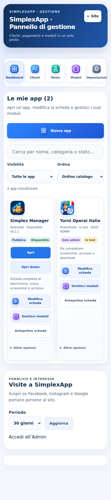
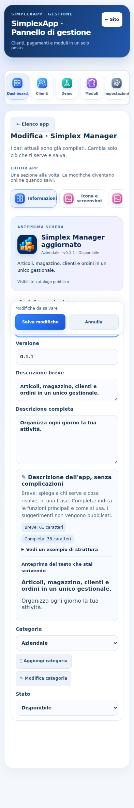
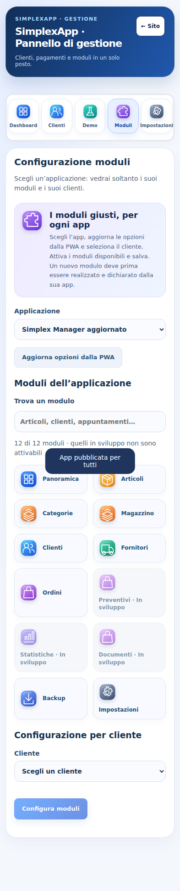

# Gestione app: revisione dell’interfaccia

Questa revisione riguarda il pannello privato di SimplexApp. È preparata su un ramo separato; non aggiorna main né il gestionale pubblico Simplex Manager. Non crea ambienti o progetti Supabase.

## Cosa cambia

- Elenco app in due colonne anche su smartphone (da 320 px), prima delle statistiche, con ricerca per nome/categoria/stato, filtro pubbliche/solo admin e ordinamento per nome o schede da completare.
- Schede con icona, indicatori di visibilità e stato, informazioni mancanti e comandi distinti per modifica, moduli e anteprima. Le azioni di eliminazione rimangono in “Altre opzioni” e mantengono la conferma esistente.
- Editor in cinque sezioni: informazioni; icona e screenshot; foto della scheda; accessi e download; pubblicazione. I campi mantengono ID, valori, upload e gestori di salvataggio esistenti.
- Anteprima locale dei testi e dell’icona, stato delle modifiche, salvataggio raggiungibile durante lo scorrimento e conferma prima di scartare una modifica.
- Sezioni Demo e Moduli raggiungibili direttamente; moduli per applicazione con ricerca, icone e stato “In sviluppo”. I moduli non disponibili restano disabilitati. “Aggiorna opzioni dalla PWA” continua a usare il relativo endpoint autenticato esistente.
- Icone SVG diverse, con gradienti e ombre, navigazione amministrativa visibile anche su 320 px; navigazione pubblica nascosta mentre si gestiscono le app.
- Asset nuovi inclusi nel service worker v73 e nel generatore di anteprima locale.

## Confini funzionali

“Aggiungere moduli” qui significa aggiornare le opzioni dichiarate dall’app e assegnare i moduli supportati ai suoi clienti. Non si possono creare funzioni eseguibili semplicemente inserendo un nome nel pannello. Il codice dei nuovi moduli deve prima essere implementato nella PWA, con i controlli del relativo backend.

La revisione non modifica autenticazione, database, regole, API, licenze, Stripe, webhook o dati del catalogo. `admin-studio.js` non esegue richieste di rete e non salva bozze in localStorage: usa i gestori autenticati già presenti. Non è un cambiamento delle autorizzazioni lato server.

## Verifiche

- `npm test`: 50 test superati, compresi anteprima senza HTML eseguibile, mantenimento valori tra sezioni, filtri senza mutare i dati, moduli non disponibili disabilitati, identificativi dei gradienti univoci e protezione dall’annullamento involontario.
- `npm run preview:build`: anteprima compilata con i nuovi asset.
- Chromium locale: elenco/filtri, tutti i cinque passaggi, modifiche al nome e al link demo inviate al gestore di salvataggio originale, moduli distinti per app, larghezze 320/393/768/1440 senza scorrimento orizzontale della pagina e senza errori JavaScript.
- Le chiamate di rete amministrative nella prova browser sono sostituite da risposte dimostrative; tutte le richieste HTTPS sono bloccate. Nessuna modifica o registrazione sul database reale.

Non è stato eseguito un salvataggio end-to-end con un account amministratore reale né un collaudo su dispositivo Android fisico. Gli screenshot sono di dati dimostrativi locali.

## Revisione e pubblicazione

Controllare la pull request e le schermate allegate. Per pubblicare questa revisione serve una decisione esplicita dopo la revisione: nessun aggiornamento di main viene effettuato da questo lavoro. Dopo la pubblicazione verificare accesso reale, lettura del catalogo e visualizzazione delle schede senza modificarne i dati.

Per annullare una futura pubblicazione dell’interfaccia, ripristinare la revisione precedente del sito o effettuare un revert del commit unito. Non ripristinare o cancellare database: questa revisione non richiede migrazioni.

